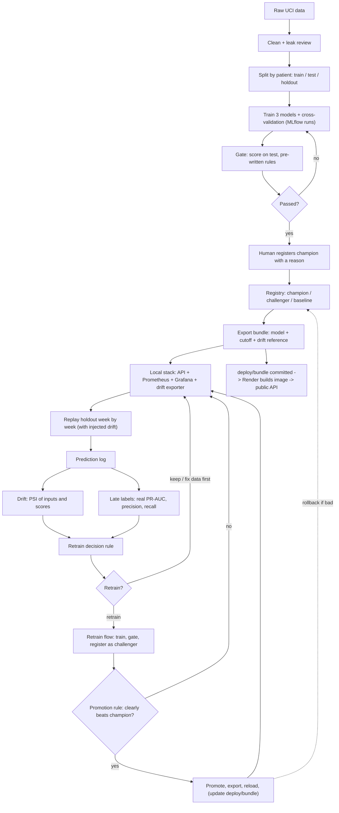
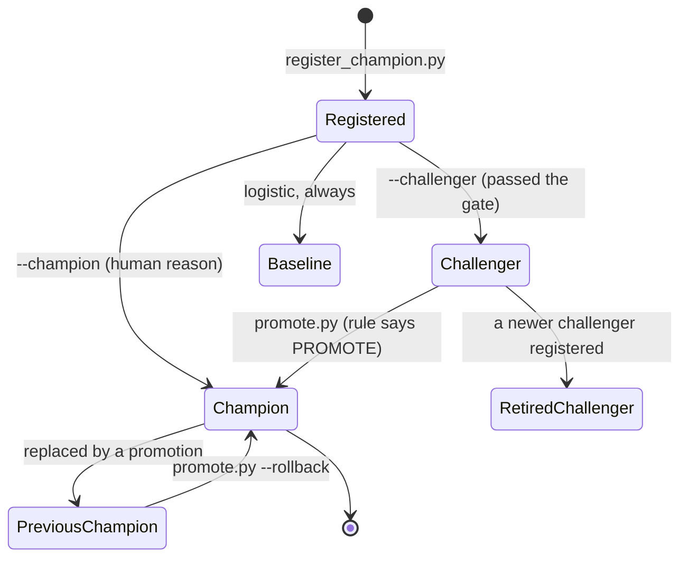

# Architecture: the MLOps life cycle of this project

This document explains how the system is put together and why. It follows a model from raw data to a live, monitored, replaceable service, and
shows who or what makes each decision along the way.

Related documents: [README](../README.md) (how to run it), [CODE_WALKTHROUGH](CODE_WALKTHROUGH.md) (every script and function),
[DEPLOYMENT_AND_MONITORING](DEPLOYMENT_AND_MONITORING.md) (Docker, Render, Prometheus, Grafana, runbooks).

> Not a clinical tool. The model has not been validated for use with real patients.

---

## Contents

1. [The problem the architecture solves](#1-the-problem-the-architecture-solves)
2. [The life cycle at a glance](#2-the-life-cycle-at-a-glance)
3. [Stage by stage](#3-stage-by-stage)
4. [Artifact lineage: what is built from what](#4-artifact-lineage-what-is-built-from-what)
5. [Who decides what](#5-who-decides-what)
6. [The model registry as a state machine](#6-the-model-registry-as-a-state-machine)
7. [The four control loops](#7-the-four-control-loops)
8. [Environments and trust boundaries](#8-environments-and-trust-boundaries)
9. [Design decisions and the reasons behind them](#9-design-decisions-and-the-reasons-behind-them)
10. [Failure modes at system level](#10-failure-modes-at-system-level)
11. [Reproducibility, audit and governance](#11-reproducibility-audit-and-governance)
12. [Privacy and security](#12-privacy-and-security)
13. [Limits of the design and what comes next](#13-limits-of-the-design-and-what-comes-next)

---

## 1. The problem the architecture solves

Training a model is a one-off. Running one is a continuing responsibility. After the first good score, six questions appear and keep returning:

| Question | Where the architecture answers it |
|---|---|
| Which model is in use, and why? | The MLflow registry (`@champion`) plus a recorded human reason on the version |
| Was it tested fairly? | Three separate data piles, a gate with rules written beforehand |
| Can it be replaced safely, and undone? | Challenger versus champion rule, aliases, rollback |
| Can someone else rebuild it? | Seeded scripts, pinned packages, data-version tags, checksums |
| Is the live service healthy and are its inputs and scores normal? | Prometheus, Grafana, drift metrics, alerts |
| Is it still **correct**, and when should it be retrained? | Late labels, the performance report, the retrain rule |

The central difficulty is **delayed ground truth**. A prediction is made at discharge, but the outcome (readmitted within 30 days) is known about a
month later. For that month the system can only watch traffic, inputs and scores. The architecture is built around that gap: fast signals that
say "something moved", and a slow, authoritative signal that says "predictions got worse".

---

## 2. The life cycle at a glance



Read it as two loops joined at the registry. The **build loop** (clean, split, train, gate, register) produces a model. The **operate loop** (serve,
log, monitor, measure, decide) tells you whether to build again. The only way back into the build loop is through a written rule, and the only way
out of it into production is through the gate and the promotion rule.

---

## 3. Stage by stage

### 3.1 Data: three piles and a leak review

| Pile | Share | Used for | Used by |
|---|---|---|---|
| Train | 60% | Learning (and cross-validation inside it) | `train.py` only |
| Test | 15% | The final exam: the gate, promotion comparisons, the flag cutoff and drift reference (scores and features only) | `test.py`, `promote.py`, `export_champion.py` |
| Holdout | 25% | Sealed; used only to simulate live traffic and to supply late labels | `replay.py`, then reports built from its log |

All splits are **by patient** (`StratifiedGroupKFold`, 20 folds grouped by `patient_nbr`, 12 / 3 / 5), so no patient appears in two piles; the script
asserts it. The leak review decides per column whether a feature would really be known at the moment of prediction (at discharge), with a written reason, and
statistics only flag suspects. `train.py` refuses to train on `test.csv` or `holdout.csv`.

### 3.2 Training: one pipeline, three models, tracked

Each model is a scikit-learn `Pipeline` of preprocessing plus estimator, so exactly the same transformation runs in training, in the gate and in the API.
Logistic regression is the **baseline**: any more complex model must beat it. XGBoost and LightGBM are the **candidates**. Every run is recorded in MLflow
(parameters, per-fold metrics, explanations, the fitted pipeline, the data version tag and training-file checksum). Models are also saved as ranked joblib
files whose names carry the CV score.

### 3.3 The gate: rules before results

`test.py` scores every saved model once, unchanged, and applies rules fixed before the first test result was seen: minimum lift, a cap on the CV-to-test drop,
beating the baseline, and fairness limits per gender, race and age group (small groups listed but not judged). The gate **never chooses** the champion. It only
says which models are eligible. Calibration is reported and not gated, because class weights deliberately inflate scores.

### 3.4 Registry: the source of truth

`register_champion.py` records models in the MLflow registry `readmission` with aliases (`champion`, `challenger`, `baseline`, later `previous_champion`) and
evidence tags (gate result, CV and test scores, training run id, the human's reason). A model that failed the gate cannot be registered. The registered copy is
verified to predict identically to the saved joblib.

### 3.5 Promotion and rollback

`promote.py` lets a challenger replace the champion only if it passes every gate check **and** its PR-AUC gain, measured with a paired patient-level bootstrap, has
a 95% range entirely above zero. A tie keeps the champion. Every decision is logged. `--rollback` swaps `@previous_champion` back. The model that is promoted is only
what the registry says; serving changes only after an export and a reload.

### 3.6 Serving: a bundle, not a database connection

`export_champion.py` turns `@champion` into a self-contained **bundle**: the model file, `meta.json` (checksum, flag cutoff, evidence, package versions, an example record)
and `reference_profile.json` (what "normal" looks like for every input and for the scores). The API loads the bundle and never talks to MLflow, because MLflow stores
absolute machine paths and SQLite does not suit mounted folders or containers. The API validates every request against the **contract read from the fitted pipeline itself**,
scores, explains with SHAP, flags with the cutoff, logs, and exposes metrics. A bad bundle is refused and the old model keeps serving.

### 3.7 Monitoring: service health

Prometheus scrapes `/metrics` and keeps history; Grafana draws it; alert rules fire on service-level symptoms (API down, flagged share outside 12% to 28%, latency,
error share, unseen categories). These tell you the **service** is behaving; they cannot tell you predictions are right.

### 3.8 Replay: rehearsing production

The sealed holdout is cut into simulated weeks (whole patients per week) and sent through the live API as if hospitals were submitting discharges. From chosen weeks one kind
of damage is injected at a time (covariate shift, population shift, new categories, bad data). The true outcomes are withheld from the API and saved. A rollback drill puts a worse
model live on purpose and recovers with the real rollback command. The replay is how the monitoring and the rollback path are proven to work before they are needed.

### 3.9 Drift: did the inputs or scores move?

PSI (population stability index) compares the share of stays per bin or category with a reference. Two tools use the same code: a weekly **report** and a continuous
**exporter** feeding Prometheus alerts. Feature PSI says the patients changed; score PSI says the model's outputs changed. They are different and neither proves predictions are worse.

### 3.10 Late labels: did the predictions get worse?

`performance_report.py` joins the logged predictions to the withheld outcomes and computes real PR-AUC, precision and recall, per week, per model version and per test, with
patient-level 95% ranges, compared with each model's gate performance. Combined with drift each week gets one of four readings: healthy, harmless drift, harmful drift, silent degradation.

### 3.11 Retrain: a rule, then a flow

`retrain.py decide` applies a written rule to pooled labelled weeks of the **live champion's version**: too few weeks means keep; pooled range not entirely below the reference means keep;
below the reference **with** never-seen category values means fix the data first; otherwise retrain. A human may force a retrain, and that is recorded as forced while the evidence decision is
kept. The Prefect flow then runs the existing scripts (train, gate, register as challenger, promotion rule) and only promotes if the promotion rule says so and `--allow-promote` was given.

### 3.12 Deployment: the public service

The model is baked into a Docker image (`deploy/Dockerfile`) built by Render from `render.yaml`. The committed `deploy/bundle/` is the deployed model; promoting to the web is "export, prepare the
bundle, commit, push". Tests and CI run on every push and pull request.

---

## 4. Artifact lineage: what is built from what

Every artifact can be traced back to its inputs. When something looks wrong, walk this table from the right-hand side to the left.

| Artifact | Built from | By | Identity or check |
|---|---|---|---|
| `diabetic_data_cleaned.csv` | raw CSV + CONFIG switches | `data_cleaning.py` | `cleaning_config.json` records every setting and row count |
| `train.csv`, `test.csv`, `holdout.csv` | cleaned CSV | `data_split.py` | seed 42, `split_assignments.csv`, asserted zero patient overlap |
| MLflow training run | `train.csv`, code, parameters | `train.py` | tags `data_tag`, `train_file`; param `train_file_sha256` |
| `NN_<model>_prauc<cv>.joblib` | the fitted pipeline | `train.py` | file name embeds rank and CV score |
| `evaluation.json` | joblibs + test split | `test.py` | matched to MLflow runs by CV score (tolerance 0.0006) |
| Registry version | MLflow run's logged pipeline | `register_champion.py` | tags: gate, scores, `training_run_id`, reason; verified against the joblib |
| `serving/bundle/*` | registry `@champion` + test scores/features | `export_champion.py` | SHA-256 of the model inside `meta.json`, written last |
| `deploy/bundle/*` | `serving/bundle/*` | `prepare_bundle.py` | checksum re-verified before copying; size limits |
| Docker image on Render | `deploy/Dockerfile`, `app.py`, `ui/`, `deploy/bundle` | Render build | git commit of the push |
| `predictions.jsonl` | requests to the API | `app.py` | model version on every line |
| `labels.csv` | holdout + week assignment | `replay.py` | same seed, `plan.json` |
| `performance_summary.json` | predictions + labels + `evaluation.json` | `performance_report.py` | per-version references |
| `trigger.json` | performance (+ drift) summary + `champion.json` | `retrain.py` | records `forced` and `evidence_decision` |
| New registry version | retrain flow | `train.py` ... `register_champion.py --challenger` | `data_tag = retrain-<id>`, backup in `models_before/` |

---

## 5. Who decides what

The design deliberately separates **judging** from **choosing**, and puts a person or a written rule at every irreversible step.

| Decision | Made by | How | Recorded where |
|---|---|---|---|
| Is a column allowed as a feature? | A person (hand-written table) | Reason per column; statistics only flag | `leak_review_columns.csv` |
| Does a model meet the bar? | The gate (rules fixed in advance) | Pass/fail checks | `evaluation.json` |
| Which model is the first champion? | **A person** | `register_champion.py --champion X --reason "..."` | Version tag `selection_reason`, `champion_report.md` |
| Does a challenger replace the champion? | The promotion rule | Gate checks + paired 95% range above zero | `promotion_log.jsonl`, `promotion_report.md` |
| Should we retrain? | The retrain rule (or a person, marked forced) | Pooled labelled weeks vs reference | `trigger.json` |
| Is it a data problem rather than a model problem? | The retrain rule (unseen categories) | `__unseen__` in drift detail | `trigger.json` |
| Which challenger does the flow register? | A rule written in advance | Highest test PR-AUC among non-baseline models that passed | `retrain_report.md` |
| Does the flow promote? | The promotion rule **and** `--allow-promote` | Two independent conditions | `promotion_log.jsonl` |
| Does the public site change? | A person | `prepare_bundle.py`, commit, push | Git history |
| Roll back | A person | `promote.py --rollback` | `promotion_log.jsonl` |

Rules written in advance (gate thresholds, the promotion rule, the retrain rule) must not be loosened after seeing results; unit tests pin the retrain rule.

---

## 6. The model registry as a state machine

Aliases are movable labels on registered versions. Which alias a version holds is its state.



Rules enforced in code: a model that failed the gate cannot enter any state; a challenger identical to the champion's run is refused; re-running champion mode after a promotion
is refused unless `--force`; the baseline is always registered even though it may fail the gate.

---

## 7. The four control loops

The system watches at four speeds. Each loop answers a different question and has a different cost of being wrong.

| Loop | Speed | Signal | Question | Reaction |
|---|---|---|---|---|
| Service health | Seconds to minutes | Request rate, latency, errors, health | Is the service working? | Alerts, restart, fix the deployment |
| Data health | Minutes to a week | Feature PSI, score PSI, unseen categories, rejected requests | Did the inputs or outputs move? | Investigate the data first; do not retrain on a data problem |
| Performance | Weeks (label delay about 30 days) | Real PR-AUC, precision, recall against the reference | Did predictions get worse? | Feeds the retrain rule |
| Governance | Per change | Gate, promotion rule, audit logs | Is this model allowed to go live? | Promote, keep, or roll back |

The key design point: **fast loops can say "look", only the slow loop can say "act".** A drift alert can ring before any label exists, and you can check the data
immediately, but whether predictions got worse has to wait for labels. The replay showed why this matters: covariate shift and new categories both hurt performance, population shift
did not, and the weaker baseline model was invisible to every label-free signal.

---

## 8. Environments and trust boundaries

```
  Developer machine (trusted)                          Public internet (untrusted)
  --------------------------------------------         ----------------------------------
  .venv        training, gate, registry, reports       Render web service (free plan)
  .venv-prefect  Prefect flow                            - image with the model baked in
  MLflow (mlflow.db + mlruns/)  source of truth          - no prediction log, MAX_RECORDS 100
  Docker stack:                                          - /reload needs ADMIN_TOKEN
    API :8000   drift exporter :9100                     - /metrics is public
    Prometheus :9090  Grafana :3000 ---- scrapes /metrics over HTTPS ---->  (job readmission-render)
  GitHub (code + deploy/bundle, no data, no logs)  --push-->  Render builds and deploys
```

| Environment | Holds | Does not hold |
|---|---|---|
| Developer machine | Data, splits, MLflow, joblibs, prediction log, replay outputs | Nothing leaves it except what is committed |
| GitHub | Code, configs, docs, raw UCI files, `deploy/bundle/` (the deployed model), four plain-language reports | Splits, MLflow, `serving/bundle`, logs, `.env`, patient-level rows |
| Render | The image (model + app + console) | Training data, MLflow, a persistent prediction log |
| Local Prometheus and Grafana | Metric history (named Docker volumes) | Anything about individual patients |

**Why two model copies.** `serving/bundle/` is local, mounted, ignored by git. `deploy/bundle/` is the committed copy the image is built from, because a hosted service has no mounted folders.
Updating one does not update the other, so the promotion recipe always runs both steps.

**Drift on the public service.** The drift exporter reads a local prediction log, and the public service logs nothing by design (patient-level rows, temporary disk). So drift and late-label
performance cover the local stack and replay, while the public service is covered by service metrics only.

---

## 9. Design decisions and the reasons behind them

| Decision | Alternative | Why this way |
|---|---|---|
| Split by patient | Random row split | A random split would put 41.5% of test rows with a patient also in train (measured in the leak review), inflating scores |
| PR-AUC as the main metric | Accuracy, ROC-AUC | With 11.5% positives accuracy is meaningless; PR-AUC looks only at how well the rare positives are ranked |
| One pipeline object for prep + model | Separate preprocessing in the API | Identical transforms everywhere; the API derives its input contract from the fitted pipeline, so there is no second copy to drift |
| Gate thresholds fixed in code, human chooses champion | Automatic best-model selection | Judging and choosing are different jobs; two statistically tied models were separated by a person on credible feature reasoning, not by 0.002 of CV score |
| Promotion needs a paired 95% range above zero | Promote any higher score | A tie is not a reason to switch; the test split is spent, so only a clear win counts |
| Aliases in a registry | File names | "Which model is champion?" must have one authoritative answer that code can query |
| API loads a bundle with a checksum, written last | API reads MLflow | MLflow paths are machine-specific; the checksum makes an unfinished export fail safe |
| Atomic reload, old model keeps serving on failure | Restart the service | Promotions and rollbacks happen under traffic with no failed requests (shown in the drill) |
| Unseen categories are scored and counted, not rejected | Reject unknown values | Real systems add codes; rejecting would drop stays. The count is a drift signal |
| Nulls and wrong types are rejected with named columns | Silently impute | Bad data should fail loudly at the edge, and the caller can fix it |
| Flag cutoff = top 20% of reference scores | A fixed probability threshold | Scores are class-weighted and not calibrated, so a probability threshold would mean nothing |
| Cutoff recomputed on every export | Fixed cutoff | Different models have different score scales; but note this hides a worse model from flagged-share monitoring (see section 10) |
| Feature drift and score drift measured separately | One drift number | They answer different questions; the replay showed each can be silent while the other rings |
| Retrain rule uses only the live champion's weeks | Pool everything | A mid-run model swap would blur the answer |
| Unseen categories + low performance = fix data first | Always retrain | Retraining on a broken feed reproduces the break |
| Prefect in a separate environment, scripts run as subprocesses | One environment, imports | Prefect's dependencies must not disturb pinned MLflow, pydantic and scikit-learn; a crash in one script cannot corrupt the flow |
| Flow is dry-run by default, `--allow-promote` is a separate switch | Fully automatic | Each increase in blast radius needs its own explicit opt-in |
| Prometheus runs locally and scrapes Render | Hosted monitoring | Free plans lack persistent disks; local scraping is the simplest way to see public traffic |
| Light and dark console with no external libraries | A frontend framework | Works offline and inside Docker; nothing to build |

---

## 10. Failure modes at system level

What can go wrong across stages, how it shows up, and what limits the damage.

| Failure | How it shows up | Containment | Recovery |
|---|---|---|---|
| Leakage in a feature | Gate or live performance too good, whole-model AUC above 0.75 | Leak review table, grouped splits, train-file guard | Remove the column, rerun from `train.py` |
| Overfitting to the test split | Gradual optimism over many comparisons | Promotion demands a clear win; holdout kept for the replay | Use fresh data for further checks |
| A worse model promoted by mistake | Not visible in flagged share (cutoff is recomputed), slight rise in mean score | Promotion rule, rollback, `previous_champion` | `promote.py --rollback`, export, reload, (update `deploy/bundle`) |
| Corrupt or half-written bundle | Checksum mismatch | Old model keeps serving; `prepare_bundle.py` refuses unverified models | Re-export |
| Broken upstream feed | Unseen categories, rejected requests, error-share alert, feature PSI | API rejects bad rows; retrain rule refuses to retrain on unseen categories | Fix the feed, do not retrain |
| Covariate shift | Flagged share about 49%, feature PSI above 1, real PR-AUC drops | Replay alert, drift alert, performance report | Retrain candidate if pooled performance is below the reference |
| Population shift that does not hurt | Age PSI moderate, performance consistent | Harmless drift reading | Keep watching |
| Silent degradation | Performance below reference with no drift | Only labels can see it | Investigate; retrain if it persists |
| Package mismatch between training and serving | `package_warnings` in `/model-info`, or load errors | Pinned versions, shared pins in `serving/requirements-serve.txt` | Rebuild the image |
| MLflow database lost | Registry and history gone | Joblibs survive; backups before retrain | Re-register from joblibs (needs matching runs), or retrain |
| Free Render instance asleep or restarted | First request slow; counters reset | Health check, `rate()`/`increase()` in queries | Wait; nothing to fix |
| Docker engine down locally | Commands hang with only a Client section | Production service is independent of it | Restart Docker Desktop |

**A deliberate blind spot, documented.** Because each export recomputes the cutoff for the exported model, the flagged share stays near 20% even when a weaker model is live. This is the
reason the architecture needs the late-label loop: no label-free signal can see "worse".

---

## 11. Reproducibility, audit and governance

| Need | Mechanism |
|---|---|
| Same numbers on a rebuild | Seed 42 everywhere; pinned packages; `python test.py --no-mlflow` should print LightGBM 0.222, XGBoost 0.218, logistic 0.206 |
| Know which data trained a model | `data_tag`, `train_file`, `train_file_sha256` on every MLflow run |
| Know who looked at the sealed data | `models/data_use_log.jsonl` (test, holdout, bundle exports, replay runs, performance reports) |
| Know every decision | `models/promotion_log.jsonl` (rejections, promotions, drill swaps, rollbacks, retrain flow outcomes), `data/retrain/*/trigger.json` |
| Know why a model is champion | The `selection_reason` tag and `champion_report.md` |
| Undo a retrain | `data/retrain/<id>/models_before/` backup, `promote.py --rollback`, git history for `deploy/bundle` |
| Prevent silent rule changes | Gate and retrain constants live in code with unit tests; changes appear in git |
| Check the code on every change | CI: lint for real errors, `pytest`, Docker builds |

Append-only logs record a decision; the regenerated reports describe the latest state. Use the logs for history and the reports for the current picture.

---

## 12. Privacy and security

- **Data.** The dataset is public and de-identified, but the prediction log and `labels.csv` still hold patient-level rows. They stay out of git and are not kept on the public service (`LOG_PREDICTIONS=false`).
- **Public API.** The score is a ranking, not a probability, and the console says it is not a clinical tool. Do not send real patient data to the demo.
- **Admin surface.** `POST /reload` requires `X-Admin-Token` when `ADMIN_TOKEN` is set (Render generates one). `/metrics` is public.
- **Request size.** `MAX_RECORDS` is 100 on Render (500 locally) to limit the work one public request can ask for.
- **Containers.** Non-root user; read-only mounts for the bundle and console locally.
- **Console.** All server data is rendered as text nodes, never as HTML.
- **Secrets.** `.env` (for example `GRAFANA_PASSWORD`) is git-ignored; the default Grafana login is admin / admin and must be changed before exposing the port.
- **Provenance.** Checksums on bundles, a data-use ledger, and an audit log make tampering and accidental reuse visible.

---

## 13. Limits of the design and what comes next

**Limits.**
- No dates in the data, so time is simulated by shuffling whole patients into weeks; real temporal behaviour is untested.
- Damaged replay weeks keep their original outcomes, so they are stress tests, not real changes in the world.
- A week has about 240 readmissions, so a single week is a noisy judge; decisions use pooled weeks.
- A modestly worse model (about 0.016 PR-AUC) cannot be separated by labels at this volume; it is better caught by comparing it as a challenger.
- Scores are not calibrated probabilities.
- Drift and late-label monitoring cover the local stack; the public service has service metrics only.
- Alerts are visible on Prometheus's page but are not routed to email or chat; alert rules and the starter dashboard do not yet distinguish the local and Render jobs.

**Next steps, in order of value.**
1. Alertmanager notifications and per-job alert rules and dashboards.
2. Calibration, so scores can be read as probabilities, and an experiment on how the model treats never-seen category values.
3. A sanitised prediction log shipped to proper storage, extending drift and performance monitoring to the public service.
4. Protecting `/predict` (API key or rate limit) and `/metrics` (token) on the public service.
5. A scheduled retrain (a Prefect deployment on a timer) fed by a real label stream.
6. More unit tests around the gate helpers and the promotion rule.